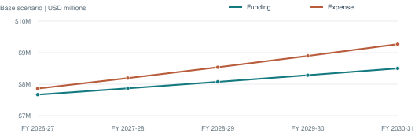

# Civic Operating Budget Analysis

### Excel + SQL for expense review and operating-budget planning

An independent portfolio project by **Sileshi Hirpa**, built with AI assistance and informed by business analytics and database coursework.

**Synthetic data throughout.** This project is not affiliated with the City of Alameda and uses no actual city financial records.

**[Read the employer report](reports/Civic_Operating_Budget_Analysis_Report.pdf)** · **[Download Excel](https://raw.githubusercontent.com/sileshith/civic-operating-budget-analysis/main/excel/Budget_Analysis_Portfolio.xlsx)** · **[Review the SQL](sql/queries/)** · **[See validation](reports/validation/validation.md)**

## Business question

Which departments and accounts are above budget, how does projected spending compare with available funding, and what spending level does the selected scenario imply for a two-year planning period?

- **Budget review:** compare matching full-year budgets and actuals; identify expense exceptions by department and account.
- **Planning:** use explicit growth assumptions for a five-year operating forecast and an FY 2027-29 spending proposal.
- **Reporting:** reconcile formula-driven Excel outputs with SQL and communicate assumptions and limits.

## Snapshot findings

Published **Base scenario**, October 23, 2026. All amounts are fictional model results.

| Measure | Result |
|---|---:|
| Monthly financial records | 360 |
| Fictional departments / accounts | 3 / 5 |
| FY 2025-26 expense budget | $7,220,000.00 |
| FY 2025-26 actual expense | $7,545,050.00 |
| Expense above budget | $325,050.00 |
| FY 2027-29 modeled operating expense | $16,729,293.39 |
| FY 2027-29 funding shortfall | $786,462.85 |



Expense growth exceeds funding growth under the selected assumptions. This is an intentionally constructed planning scenario, not a finding about actual city operations. The [four-page report](reports/Civic_Operating_Budget_Analysis_Report.pdf) explains the department variances and appropriate follow-up questions.

## Skills demonstrated

| Area | Evidence |
|---|---|
| Excel | SUMIFS, COUNTIFS, scenario selection, linked assumptions, variance formulas, native chart and source reconciliations |
| SQL / SQLite | Relational joins, constraints, aggregate views, DENSE_RANK, ROW_NUMBER and a recursive forecast CTE |
| Budget analysis | Department comparisons, matching fiscal periods, five-year projections and a two-year planning subtotal |
| Quality and communication | Independent currency calculations, nine model tests, workbook-to-SQL comparisons and an employer-facing PDF |

## Repository structure

```text
budget-analysis-portfolio/
├── README.md
├── CITATION.cff
├── requirements-report.txt
├── .github/workflows/validate.yml
├── assets/figures/             # Report and README charts
├── data/
│   ├── raw/                   # Synthetic CSV inputs and growth rates
│   ├── processed/             # SQLite database and model snapshot
│   └── manifest.json          # Seed, scope, export case and input hashes
├── docs/                      # Methodology, dictionary, interview and usage guides
├── excel/
│   └── Budget_Analysis_Portfolio.xlsx
├── scripts/                   # Rebuild, tests, PDF generator and release checks
├── sql/
│   ├── schema/               # Tables, constraints, index and views
│   └── queries/              # Variance, exceptions and forecast
└── reports/
    ├── Civic_Operating_Budget_Analysis_Report.pdf
    ├── findings.md
    ├── exports/              # SQL result CSVs
    └── validation/           # Checks and release evidence
```

## Reproduce the analysis

Run from the repository root with Python 3.11 or 3.12:

```sh
python3 scripts/rebuild.py
python3 scripts/test_model.py
python3 scripts/verify_release.py
```

These commands use the standard library. No credentials, cloud service or live database connection is needed. The generator seed is **407409**. Rebuilding replaces generated data and SQL exports; it does not change Excel.

To rebuild the PDF and chart assets:

```sh
python3 -m pip install -r requirements-report.txt
python3 scripts/build_report.py
```

To export the alternate SQL forecast, run `python3 scripts/rebuild.py --case Constrained`. Run the default command to restore published Base exports. The PDF builder always reports Base and queries SQLite directly.

The GitHub Actions workflow runs the model checks, verifies saved workbook results and rebuilds the PDF on pushes and pull requests using Python 3.11 and 3.12. See the repository Actions tab for the current hosted run status.

## Explore Excel

Follow **Monthly data → Summary → Assumptions → Department plan → Review**. Choose Base or Constrained in `Assumptions!D4`. Forecasts update while historical actuals remain unchanged.

The fiscal convention is July-June, labeled by ending year. The FY 2027-29 proposal includes FY 2027-28 and FY 2028-29, rather than the first two forecast years.

**Excel is an embedded snapshot, not a live SQLite connection.** SQL exports do not automatically refresh Excel; Excel edits do not update SQLite. See the [technical guide](docs/technical_guide.md) for the refresh boundary.

## Validation and practical limits

- Nine local model tests pass, covering duplicate/missing data, fiscal dates, foreign keys, zero denominators and rounding boundaries.
- Both scenarios' 75 account/year projections match independent Decimal calculations.
- All 75 saved Base workbook forecasts match SQL; no cached formula errors were found.
- Every workbook sheet's main view was visually inspected. Desktop Excel recalculation was not independently certified.
- The PDF is generated from read-only SQLite and explicitly identifies its synthetic basis.

Assigned support is a funding allocation within this scope, not additional consolidated municipal revenue. The operating gap does not measure cash, reserves or fund balance. No detailed staffing, pension, capital, encumbrance or legal appropriation model is included. No actual savings, municipal employment or Tyler Munis/OpenGov/TrueComp experience is claimed.

## Background and authorship

This new simulation applies concepts from ASU Excel and database coursework without reproducing course answer keys. AI assisted implementation, documentation and verification. Review and understand the work before presenting it as a portfolio example.

See the [methodology](docs/methodology.md), [data dictionary](docs/data_dictionary.md), [interview guide](docs/interview_guide.md) and [publishing guide](docs/publishing.md).
